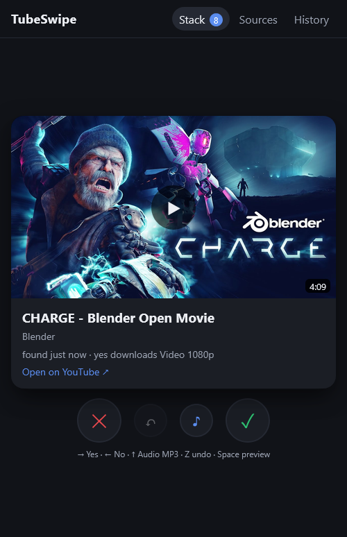

# TubeSwipe

Swipe through new videos from YouTube channels and playlists, and send the ones you want to [MeTube](https://github.com/alexta69/metube).

MeTube's subscriptions download everything a channel publishes. TubeSwipe asks first: every new video becomes a card. Swipe right and MeTube downloads it, swipe left and it is gone for good, swipe up to grab it in the other format (audio instead of video, or the other way round).

<p align="center"></p>

- No YouTube API key, no yt-dlp of its own: TubeSwipe lets MeTube list the videos of a source.
- A yes waits 8 seconds before it goes to MeTube, so you can still take it back.
- Decisions stick. A video you dismissed never comes back, even if you remove and re-add its channel.
- Works on the phone (swipe) and on the desktop (arrow keys). English and German, picked from the browser.
- One small Node process without dependencies; all state lives in a single JSON file.

## Quick start

You need Docker with Compose. Save [`compose.yml`](compose.yml) in an empty folder and run:

```sh
docker compose up -d
```

Open http://localhost:3000, go to **Sources** and paste a channel (`https://www.youtube.com/@name`) or a playlist (`…/playlist?list=…`). Choose how many of the existing videos to suggest (none, the latest 5, 10, 25 or all) and what a yes should download. TubeSwipe then checks every source once an hour.

Downloads land in `./downloads`, as with any MeTube. If you already run MeTube, drop the `metube` service from the file and point `METUBE_URL` at yours.

> [!WARNING]
> TubeSwipe has no accounts. Anyone who can open it can trigger downloads and change sources. Keep it inside your network or VPN, put it behind a reverse proxy with authentication (Authelia, Authentik, …), or at least set `AUTH_USER` and `AUTH_PASSWORD`. The same goes for MeTube itself.

## Swiping

| Gesture | Key | Effect |
| --- | --- | --- |
| right | → | yes: send to MeTube with the source's download setting |
| left | ← | no: dismiss for good |
| up | ↑ | yes, in the other format (audio MP3 or best video) |
| | Z or Backspace | undo the last decision |
| tap the thumbnail | Space | play the video inside the card |

**History** lists every decision; from there a video can go back into the stack, and a failed send can be retried. MeTube errors are retried after one and two minutes.

**Private playlists and Watch later.** MeTube cannot read private playlists, "Watch later" or "Liked videos" without YouTube cookies, so TubeSwipe refuses them. Use an **unlisted** playlist as your inbox instead: save videos into it from the YouTube app and add it to TubeSwipe with "all".

## Configuration

All settings are environment variables.

| Variable | Default | Meaning |
| --- | --- | --- |
| `METUBE_URL` | `http://metube:8081` | Where TubeSwipe reaches MeTube |
| `UI_LANGUAGE` | `auto` | `auto` follows the browser; `en` or `de` fixes the language |
| `POLL_MINUTES` | `60` | How often each source is checked (at least 5) |
| `CHANNEL_LIMIT` | `50` | How many of a channel's newest videos are read per check; playlists are always read in full |
| `SEND_DELAY_SECONDS` | `8` | How long a yes can be taken back before it goes to MeTube |
| `AUTH_USER`, `AUTH_PASSWORD` | – | Turn on HTTP basic auth for everything except `/api/health`; set both or neither |
| `PORT` | `3000` | Port inside the container |
| `DATA_DIR` | `/data` | Where `state.json` is kept |
| `DUPLICATES` | `false` | Shows the duplicate finder, see below |
| `MEDIA_DIR` | `/media` | Folders the duplicate finder scans |
| `DUP_HOURS` | `24` | How often the duplicate finder scans by itself |

A yes sends MeTube the same fields as its own subscriptions: `download_type`, `format`, `quality`, `codec: auto` and an empty `folder`. TubeSwipe was tested with MeTube 2026.10.09; it relies on MeTube's `/browse` endpoint, which older versions do not have.

## Optional: duplicate finder

If several tools download into the same library, the same video can end up there twice. With `DUPLICATES=true` a fourth tab scans the folders under `MEDIA_DIR` for media files with the same YouTube ID (from `[id]` in the file name, `.info.json` or `.nfo`) and the same kind, audio or video.

Nothing is deleted directly. **Move to trash** moves a file and its sidecar files (`.nfo`, `.info.json`, thumbnails) into `.tubeswipe-trash` inside the same root folder, and only **Empty trash** deletes for good. Each folder directly under `MEDIA_DIR` is one root with its own trash, so mount every library separately:

```yaml
    environment:
      DUPLICATES: "true"
    volumes:
      - tubeswipe-data:/data
      - /srv/media/youtube:/media/youtube
      - /srv/media/music:/media/music
```

The container runs as UID 1000. To move files, that user needs write access to the mounted folders; otherwise the tab only lists what it finds.

## Good to know

- TubeSwipe only knows its own decisions. A video you downloaded earlier by hand or through a MeTube subscription can still show up as a card, and a yes downloads it again.
- Taking a yes back after it reached MeTube puts the card back into the stack, but does not stop the download in MeTube.
- Channels that also run as MeTube subscriptions keep downloading automatically. Remove the subscription in MeTube when you move a channel to TubeSwipe.
- `/browse` belongs to MeTube's own web interface rather than to a documented API, so a MeTube update could change it.

## Development

Node 22 or newer, no `npm install` needed.

```sh
npm test                                         # starts the server against a mock MeTube
npm run mock                                     # mock MeTube on port 8081 with sample videos
METUBE_URL=http://localhost:8081 DATA_DIR=./data npm start
```

The image is built and published to `ghcr.io/ramuron/tubeswipe` by GitHub Actions for `linux/amd64` and `linux/arm64`. To build it yourself: `docker build -t tubeswipe .`

## License

[MIT](LICENSE). TubeSwipe is not affiliated with YouTube, Google or MeTube. The screenshot shows Blender Foundation open movies (CC BY).
